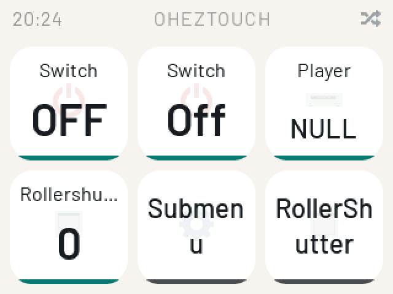
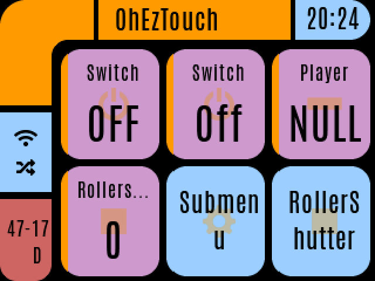
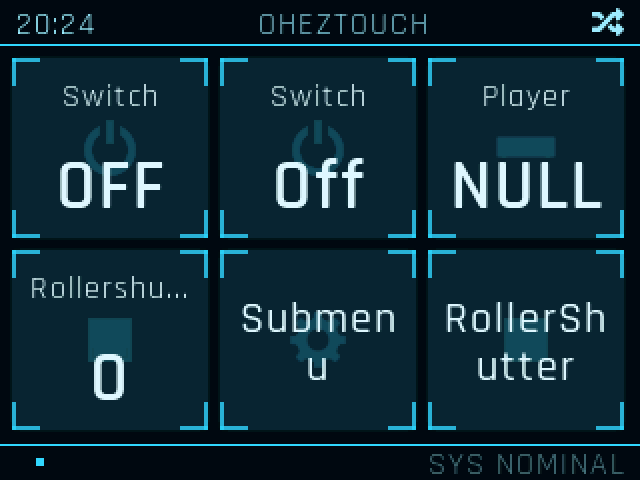
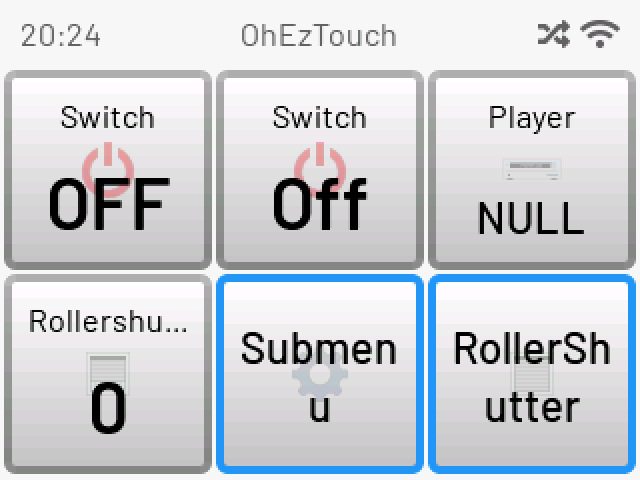
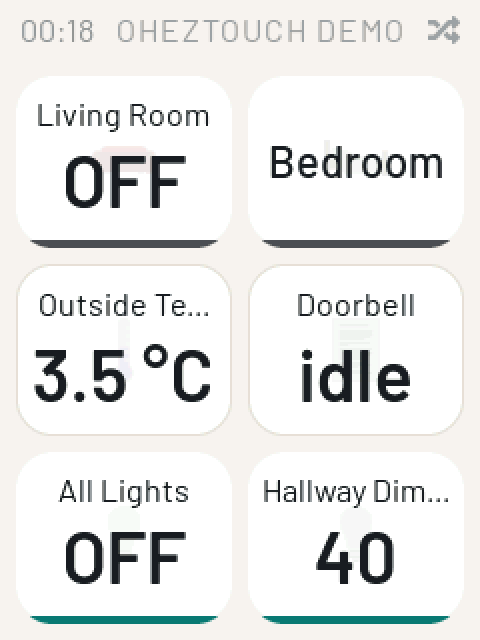
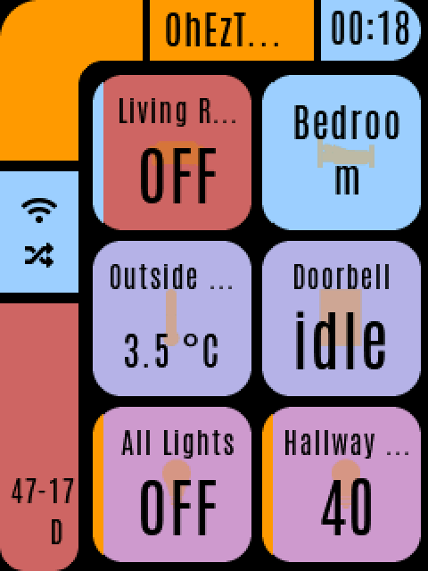
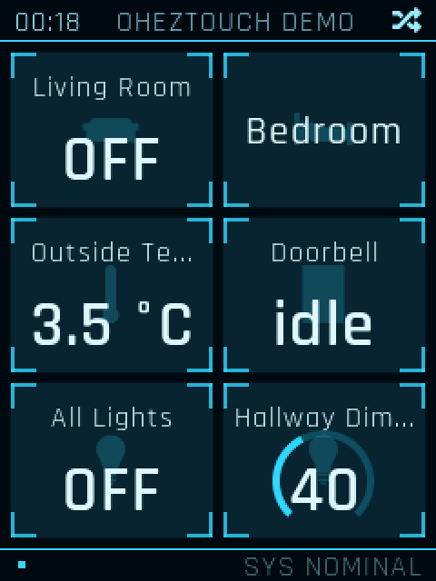
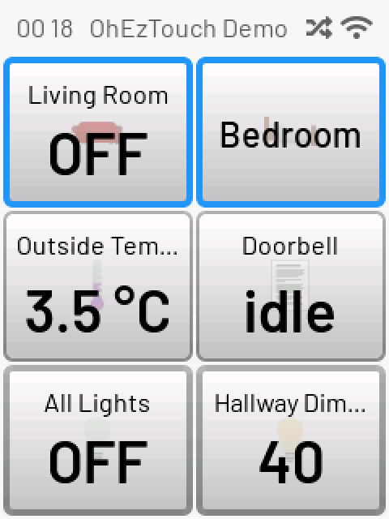

[English](README.md) | **Deutsch**

# OhEzTouch


OhEzTouch ist ein ständig aktives Touch-Bedienfeld für Hausautomationssysteme,
die von [openHAB](https://www.openhab.org/) gesteuert werden. Das Bedienfeld
läuft auf einem ESP32. Es erstellt seine Touch-Schaltflächen und Grafiken
dynamisch anhand einer openHAB-Sitemap auf dem Server.

## Funktionen

- Dynamische Benutzeroberfläche auf Grundlage einer openHAB-Sitemap
- Zustandsänderungen von Items werden von openHAB übertragen; ersatzweise werden sie regelmäßig abgefragt
- Türklingel und Kamerabilder: Das Bild eines Image-Items wird bei Berührung angezeigt; klingelt es, erscheint es automatisch unabhängig von der aktuellen Seite
- Uhranzeige bei Inaktivität: die Uhrzeit und drei Items nach Wahl in eigenen Tag- und Nachtfarben, mit Schwarzblende ein- und ausgeblendet
- Vier Designs: Material, LCARS, JARVIS, Classic
- Quer- oder Hochformatmontage in jedem Design
- Touchscreen-Kalibrierung direkt am Bedienfeld; die Korrektur wird vor dem Übernehmen angezeigt
- Weboberfläche und REST-API zur Konfiguration
- MQTT-Client: Status, Sensoren, Fernkonfiguration, Töne
- Bluetooth-LE-Beaconscanner (iBeacon, Eddystone)
- Unterstützung für den Temperatur-, Feuchtigkeits- und Drucksensor BME280
- Relais- und LED-Ausgänge auf unterstützten Boards
- Firmware-Updates über WLAN, für einzelne Geräte oder ganze Geräteflotten
- Desktop-Simulator für die Entwicklung ohne Hardware

## Designs

Der Hauptbildschirm in jedem der vier Designs:

| Material | LCARS |
| --- | --- |
|  |  |
| **JARVIS** | **Classic** |
|  |  |

Jedes Design wird auch aufrecht dargestellt, wenn das Bedienfeld senkrecht
montiert ist (`Orientation: portrait`, siehe [doc/configuration_de.md](doc/configuration_de.md)):

| Material | LCARS | JARVIS | Classic |
| --- | --- | --- | --- |
|  |  |  |  |

## Unterstützte Hardware

| Board | Dokumentation |
| --- | --- |
| ArduiTouch 2.4 inch | [doc/hardware/arduitouch_de.md](doc/hardware/arduitouch_de.md) |
| ArduiTouch 2.8 inch | [doc/hardware/arduitouch28_de.md](doc/hardware/arduitouch28_de.md) |
| Lanbon L8 | [doc/hardware/lanbon_de.md](doc/hardware/lanbon_de.md) |
| Cheap Yellow Display (ESP32-2432S028R) | [doc/hardware/cyd_de.md](doc/hardware/cyd_de.md) |

Die Benutzeroberfläche läuft auch auf einem Linux-Desktop. Siehe
[doc/simulator_de.md](doc/simulator_de.md).

## Schnellstart

```bash
# 1. Install ESP-IDF v6.1
mkdir -p ~/esp
git -C ~/esp clone -b v6.1 --depth 1 --recursive https://github.com/espressif/esp-idf.git
~/esp/esp-idf/install.sh esp32
. ~/esp/esp-idf/export.sh

# 2. Get the code
git clone --recurse-submodules https://github.com/c5n/oh-ez-touch.git
cd oh-ez-touch

# 3. Build (example: ArduiTouch 2.4 inch)
idf.py -B build/arduitouch -DSDKCONFIG=build/arduitouch/sdkconfig \
       -DSDKCONFIG_DEFAULTS="sdkconfig.defaults;sdkconfig.defaults.esp32;sdkconfig.defaults.arduitouch" \
       set-target esp32
idf.py -B build/arduitouch build

# 4. Flash
idf.py -B build/arduitouch -p /dev/ttyUSB0 flash
```

Details finden Sie unter [doc/building_de.md](doc/building_de.md).

Ein neues Gerät öffnet einen Access Point und zeigt seinen Namen und seine
Adresse auf dem Bildschirm an. Verbinden Sie sich damit, geben Sie Ihre
WLAN-Zugangsdaten ein und wählen Sie Ihren openHAB-Server aus. Siehe
[doc/configuration_de.md](doc/configuration_de.md).

## Dokumentation

| Dokument | Inhalt |
| --- | --- |
| [doc/building_de.md](doc/building_de.md) | Toolchain sowie Anleitungen zum Bauen und Flashen |
| [doc/configuration_de.md](doc/configuration_de.md) | WLAN-Einrichtung, Einstellungen, Weboberfläche, REST-API |
| [doc/sitemap_de.md](doc/sitemap_de.md) | Unterstützte Sitemap-Elemente und Beispiele |
| [doc/openHAB/README_de.md](doc/openHAB/README_de.md) | Eine openHAB-Demokonfiguration, die alle Funktionen anhand von Bildern zeigt |
| [doc/mqtt_de.md](doc/mqtt_de.md) | MQTT-Topics, Fernkonfiguration, Töne, Relais und LEDs |
| [doc/ble_de.md](doc/ble_de.md) | Bluetooth-LE-Beaconscanner |
| [doc/update_de.md](doc/update_de.md) | Over-the-Air-Updates, Geräteflotten-Rollout, Wiederherstellungs-Firmware |
| [doc/simulator_de.md](doc/simulator_de.md) | Der Desktop-Simulator |
| [doc/devmgr_de.md](doc/devmgr_de.md) | Der webbasierte Geräteflotten-Manager |
| [doc/mqttviz_de.md](doc/mqttviz_de.md) | Der MQTT-Visualizer: Mesh, Topologie und das Haus in 3D aus SweetHome3D |
| [doc/architecture_de.md](doc/architecture_de.md) | Systemarchitektur und Leistungsanalyse |
| [doc/testing_de.md](doc/testing_de.md) | Unit-Tests und Test-Fixtures |
| [doc/test-interface_de.md](doc/test-interface_de.md) | Skriptsteuerungsschnittstelle des Simulators |
| [doc/openhab-fixtures_de.md](doc/openhab-fixtures_de.md) | Test-Sitemaps für einen echten openHAB-Server |
| [doc/beeper_de.md](doc/beeper_de.md) | Die Sound-Engines und Klingeltontabellen |
| [doc/fonts_de.md](doc/fonts_de.md) | UI-Schriftarten und ihre Neuerstellung |
| [doc/icon-set_de.md](doc/icon-set_de.md) | Der openHAB-Icon-Satz |
| [doc/todo_de.md](doc/todo_de.md) | Die Aufgabenliste |

## Mitwirken

Das Projekt befindet sich noch in der Entwicklung, ist aber bereits sehr gut
nutzbar.

Kommentare, Vorschläge und Codebeiträge sind willkommen. Die offenen Aufgaben
finden Sie unter [doc/todo_de.md](doc/todo_de.md).

Kontakt: c5n AT posteo DOT de

## Lizenz

[GNU General Public License v3.0](LICENSE.md)

## Danksagungen

Dieses Projekt wurde mit den folgenden Projekten und Bibliotheken erstellt.
Vielen Dank an alle Beteiligten:

- [ESP-IDF](https://docs.espressif.com/projects/esp-idf/)
- [LVGL](https://lvgl.io/)
- [ArduinoJson](https://arduinojson.org/)
- [LodePNG](https://lodev.org/lodepng/)
- [TJpgDec](https://elm-chan.org/fsw/tjpgd/) von ChaN
- Eingebettete Schriftarten: [Barlow, Rajdhani und Antonio](https://fonts.google.com/)
  (SIL OFL 1.1)

Diese Projekte werden nicht mehr verwendet, bildeten aber lange Zeit die
Grundlage dieses Projekts:

- [PlatformIO](https://platformio.org/)
- [AutoConnect](https://github.com/Hieromon/AutoConnect) (Ursprung des OTA-
  Update-Handlers)
- [TFT_eSPI](https://github.com/Bodmer/TFT_eSPI)
- [Uptime Library](https://github.com/YiannisBourkelis/Uptime-Library)
- [Adafruit BME280 Library](https://github.com/adafruit/Adafruit_BME280_Library)
