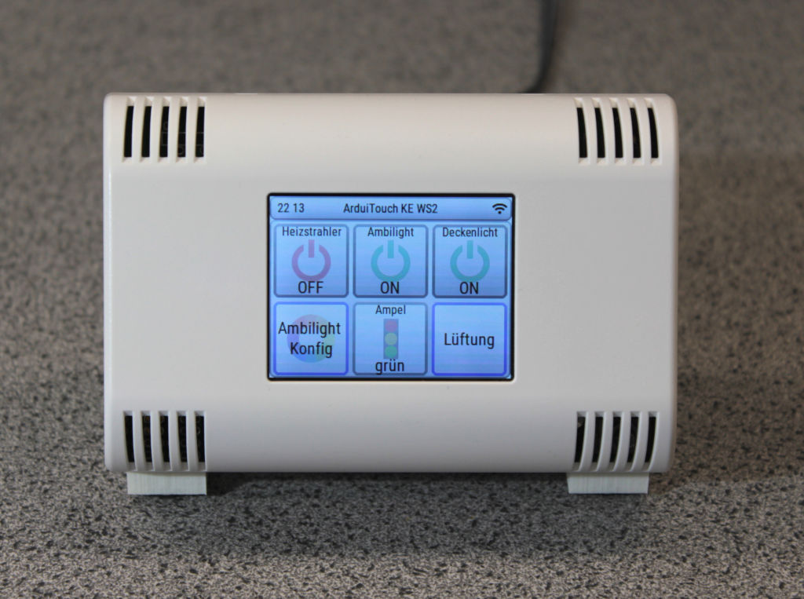

# ArduiTouch 2,4 Zoll

Das ArduiTouch ist ein Wandmontage-Kit. Es besitzt ein ESP32-Modul, ein
320x240-ILI9341-Display, ein resistives XPT2046-Touchpanel und einen
Piezo-Signalgeber.



- Build-Zielname: `arduitouch`
- Defaults-Datei: `sdkconfig.defaults.arduitouch`
- Dieses Board ist der Kconfig-Standardwert. Ein Build ohne Board-Defaults-Datei
  wird für dieses Board erstellt.

## Teile

- [ESP32 NodeMCU](https://www.az-delivery.de/products/esp32-developmentboard) oder
  [ESP32 Dev Kit C V4](https://www.az-delivery.de/products/esp-32-dev-kit-c-v4).
  Keine SD-Karte erforderlich.
- [ArduiTouch-Kit](https://www.az-delivery.de/products/az-touch-wandgehauseset-mit-touchscreen-fur-esp8266-und-esp32)

Optionale Teile, Option A (externes Netzteil):

- DC-Buchse, zum Beispiel [diese](https://www.amazon.de/dp/B0975TSZRV)
- USB-zu-TTL-Seriell-Adapter zum Flashen. Empfohlen:
  [FT232-AZ-USB-zu-TTL-Adapter für 3,3 V und 5 V](https://www.az-delivery.de/products/ftdi-adapter-ft232rl)

Optionale Teile, Option B (Netzstrom):

- [Schalter](https://www.amazon.de/dp/B0966WQRH6)
- [AC/DC-Transformator, 220 V auf 5 V](https://www.az-delivery.de/products/copy-of-220v-zu-5v-mini-netzteil)

## Stromversorgung

Schließen Sie das ArduiTouch an eine Stromversorgung mit 12 V und mindestens
300 mA an.

## Pinbelegung

Display und Touch-Controller teilen sich einen SPI-Bus. SCLK 18, MOSI 23 und
MISO 19 entsprechen exakt dem IOMUX für SPI3. Die Signale laufen nicht durch
die GPIO-Matrix.

| Signal | GPIO |
| --- | --- |
| Display-SCLK | 18 |
| Display-MOSI | 23 |
| Display-MISO | 19 |
| Display-CS | 5 |
| Display-DC | 4 |
| Display-Reset | 22 |
| Touch-CS | 14 (26 in der JTAG-Variante) |
| Hintergrundbeleuchtung | 15 (16 in der JTAG-Variante), aktiv niedrig |
| Signalgeber | 21 |
| I2C-SDA (optionaler BME280) | 33 |
| I2C-SCL (optionaler BME280) | 32 |

Der Touch-Controller ist ein zweites Gerät am Display-Bus. Er hat keine
separaten Bus-Pins. Er liest MISO über denselben Bus zurück.

Der Display-Takt beträgt 40 MHz. Die IOMUX-Verdrahtung erlaubt auf der
ESP32-Seite 80 MHz. Bei 40 MHz liegt ein ILI9341 bereits über seinem
Datenblatt-Schreibzyklus. Vor dem Einsatz von 80 MHz ist ein Test auf echter
Hardware erforderlich.

Das 2,4-Zoll-Panel ist anders herum montiert als das 2,8-Zoll-Panel. Die
Firmware dreht auf diesem Board die Zeigerkoordinaten um 180 Grad.

Die Touch-Kalibrierungskonstanten sind Ursprung 275, Spanne 3620 für X sowie
Ursprung 264, Spanne 3532 für Y. Die Spannweiten sind Spannen, keine
Maximalwerte. Details finden Sie in `main/port/esp32/board_pins.h`.

Mit diesen Werten startet ein unkalibriertes Board dieses Typs. Ein
resistives Panel unterscheidet sich von Gerät zu Gerät. Liegen die Ränder bei
Ihrem Gerät daneben, kalibrieren Sie es am Bedienfeld unter **System**,
**Touch**, **Calibrate**. Siehe
[Touchscreen kalibrieren](../configuration_de.md#touchscreen-kalibrieren).
Die Konstanten im Header bleiben die Ersatzwerte; sie gelten, wenn alle vier
Einstellungen `0` sind.

## Signalgeber

Dieses Board besitzt einen Piezo-Signalgeber an GPIO 21. Siehe
[Der Signalgeber](../beeper_de.md).

## JTAG-Variante

Die Datei `sdkconfig.defaults.arduitouch_jtag` erstellt dasselbe Board mit
einer anderen Pinbelegung. Touch-CS wird auf GPIO 26 und die
Hintergrundbeleuchtung auf GPIO 16 verlegt. Dadurch bleiben die beiden Pins
frei, die ein angeschlossener esp-prog benötigt.

## Flashen mit einem UART-Adapter

Das Board hat keinen USB-Anschluss. Verwenden Sie einen USB-zu-TTL-Seriell-Adapter.

1. Stellen Sie den Adapter mit dem Jumper auf 5 V.
2. Verbinden Sie UART VCC mit ESP32 5V.
3. Verbinden Sie UART GND mit ESP32 GND (Pin 6, dieselbe Reihe wie 5V).
4. Verbinden Sie UART RX mit ESP32 TXD.
5. Verbinden Sie UART TX mit ESP32 RXD.
6. Verbinden Sie ESP32 GND mit ESP32 GPIO 0. Dadurch wird der Flash-Modus aktiviert.

Schließen Sie den Adapter an den Computer an. Ein `ttyUSB`-Gerät erscheint,
üblicherweise `/dev/ttyUSB0`. Um einen neu angeschlossenen Adapter zu
identifizieren, führen Sie Folgendes aus:

```bash
dmesg | grep /dev/ttyUSB
```

Hat Ihr Benutzerkonto keine Zugriffsrechte für das Gerät, verwenden Sie
`sudo` oder richten Sie [udev-Regeln](https://docs.espressif.com/projects/esp-idf/en/v6.1/esp32/get-started/establish-serial-connection.html)
für den Benutzerzugriff ein.

Ein Befehl lädt den Bootloader, die Partitionstabelle, die Firmware und das
Dateisystem-Image hoch:

```bash
idf.py -B build/arduitouch -p /dev/ttyUSB0 flash monitor
```

Wenn die Ausgabe `Connecting........_____` zeigt, halten Sie die BOOT-Taste am
ESP32 gedrückt, bis der Upload beginnt.

> **HINWEIS:** In manchen Fällen funktioniert die RST-Taste anstelle der BOOT-Taste.

Das Argument `monitor` ist optional. Es zeigt das serielle Protokoll an.
Drücken Sie `Ctrl-]`, um den Monitor zu beenden.

## Hochkant-Montage

Mit der Einstellung Orientation kann dieses Board aufrecht mit 240x320
betrieben werden. Dies wurde auf dem Prüfstand mit aufrechtem Bild und
übereinstimmender Touch-Eingabe überprüft. Die Hochkantdarstellung verwendet
in `port_display.c` ausschließlich MY – MV und MX wurden aus dem
Querformat-MADCTL entfernt. Dadurch liegt bei aufrecht stehendem Panel die
obere Kante des Querformats rechts. Die entsprechende Korrektur für den Touch
ist die X-Spiegelung, die `cal_apply()` in `port_indev.c` im Hochkantmodus
hinzufügt: Die Spiegelung beider Achsen durch `touch_cal_apply()` entspricht
dem Querformat; bei Hochkantdarstellung mit nur MY wird sie nur für Y benötigt.

Wird das Panel anders herum montiert – mit der oberen Kante des Querformats
links –, ist das Bild um 180 Grad gedreht statt gespiegelt. Die Korrektur ist
die andere Ein-Spiegelungs-Kombination (nur MX); die Touch-Spiegelung wird
hierbei von X nach Y verlegt.
