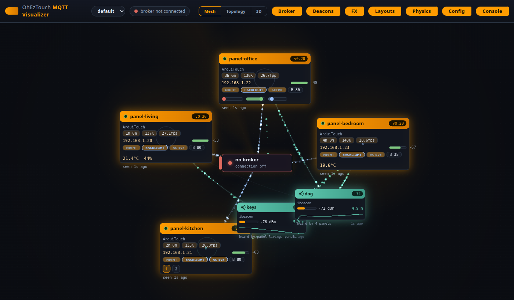
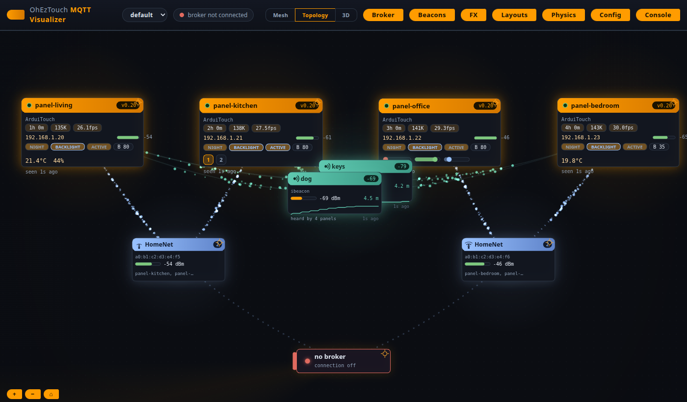
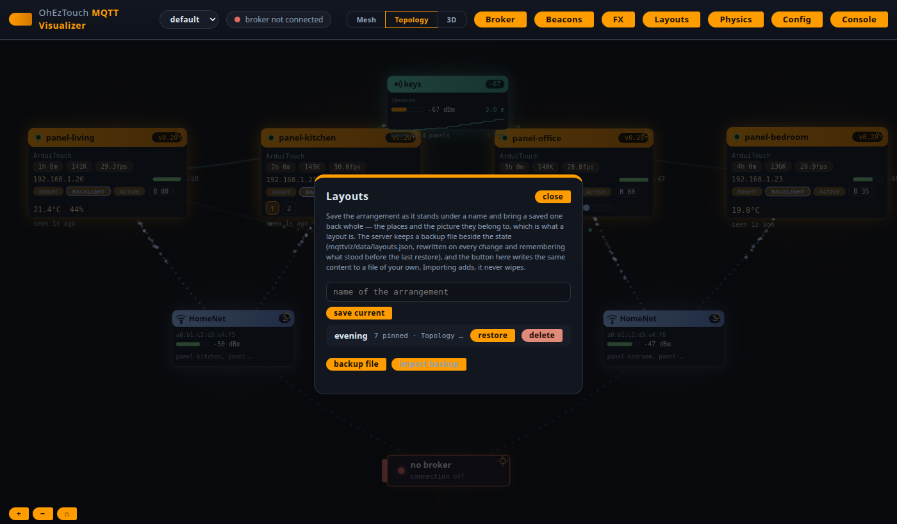
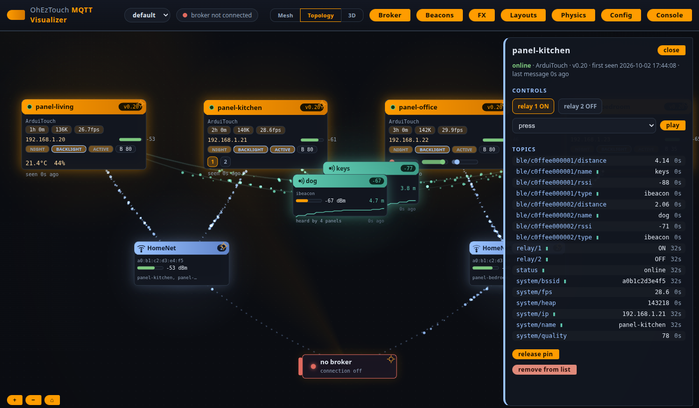
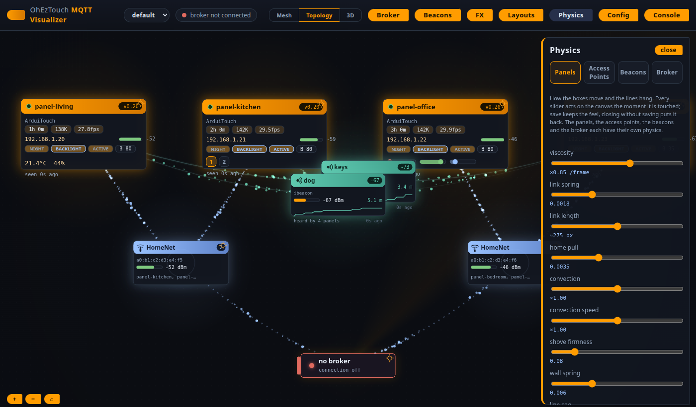
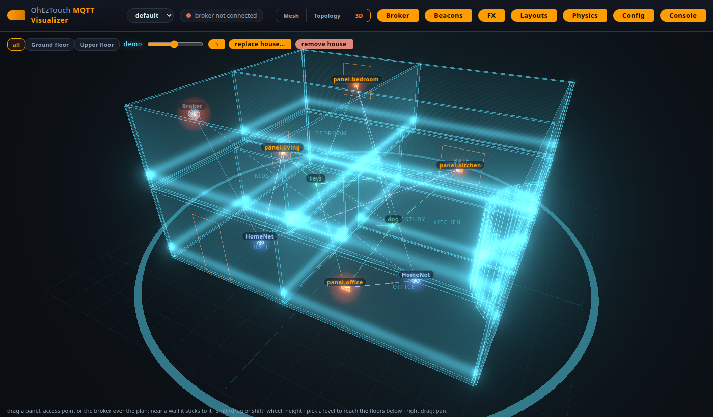
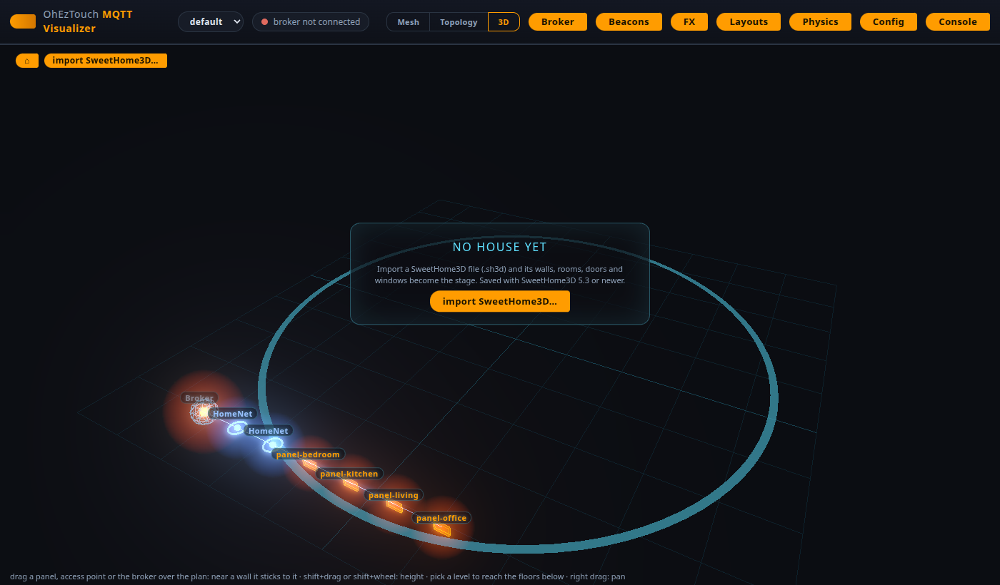
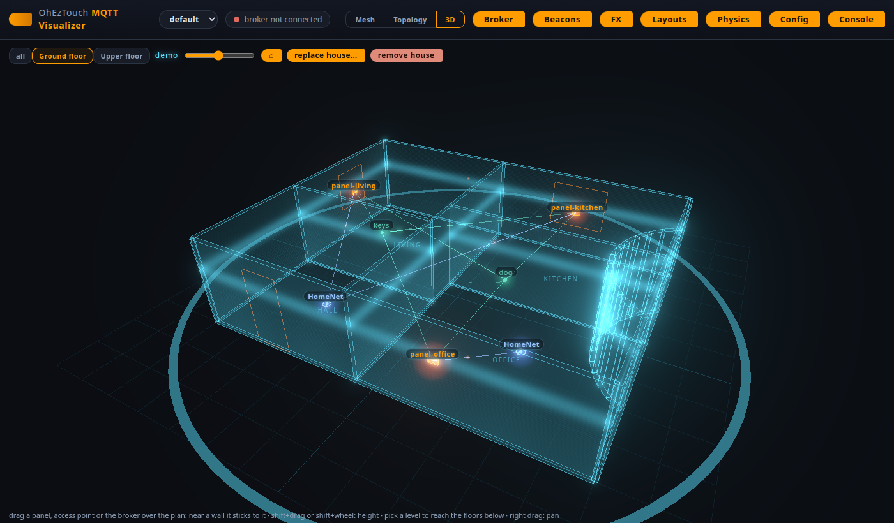

# Der MQTT-Visualizer (mqttviz/)

Eine Canvas-Ansicht aller OhEzTouch-Panels am Broker: ein Python-Skript, eine Seite auf localhost, nichts außer Python 3 muss installiert sein – nach denselben Regeln wie der [Gerätemanager](devmgr_de.md), angewendet auf die andere Hälfte der Fernschnittstelle des Panels. Während devmgr über HTTP mit der REST-API spricht, abonniert mqttviz den Broker und beobachtet, was die Panels veröffentlichen. Die Entstehungsgeschichte der Topologieansicht steht in [mqttviz-notes.md](mqttviz-notes_de.md).

    python3 mqttviz/mqttviz.py            # dann http://localhost:8089 öffnen

Jedes Panel, das unter `<base topic>/<hostname>/` gefunden wird, wird zu einem Kasten auf einer Canvas: ein Live-Bild seiner MQTT-Daten und – wenn das Panel Relais, LEDs oder Töne hat – eine Fernbedienung dafür. Die Seite stellt dieselben Daten auf drei Arten dar: im klassischen Mesh, in der Topologie aus Broker, Access Points und Panels sowie in der [Raumansicht](#die-raumansicht): dem in SweetHome3D erstellten Haus in 3D mit darin platziertem Netzwerk. Der Schalter in der oberen Leiste wählt die Ansicht.

| Option          | Standard | Bedeutung                                            |
| --------------- | ------- | -------------------------------------------------- |
| `--port`        | 8089    | Port, auf dem die Seite bereitgestellt wird       |
| `--data-dir`    | `data/` | Zustand an einem anderen Ort speichern – so vermeidet eine zweite Instanz oder ein Testlauf Änderungen an der Live-Konfiguration |
| `--mqtt-host`   | Profil | Zu überwachender Broker (Standard: `localhost`)   |
| `--mqtt-port`   | Profil | Port des Brokers (Standard: 1883)                  |
| `--user`        | Profil | Benutzername für den Broker, falls vorhanden       |
| `--password`    | Profil | Passwort für den Broker, falls vorhanden            |
| `--base`        | Profil | Zu überwachendes Basisthema (Standard: `oheztouch`) |
| `--no-mqtt`     | aus     | Ohne Verbindung zum Broker starten                 |

Befehlszeilenargumente werden in die Einstellungen des Profils geschrieben, mit dem das Tool verbunden ist. Was einmal eingegeben wurde, wird daher beim nächsten Start wiederverwendet.

## Ohne Panels ausprobieren

`mqttviz/demo/` führt den echten Visualizer mit einer eigenen Flotte aus: vier erfundene Panels an zwei Access Points und zwei zwischen ihnen umherwandernde Beacons werden so in die Registrierung eingespeist, wie es der Broker täte. Die Daten liegen in einem eigenen Verzeichnis, damit die Live-Konfiguration unberührt bleibt. Mit diesem Setup wurden die Abbildungen in dieser Anleitung erstellt.

    python3 mqttviz/demo/demo.py                     # http://localhost:8089
    python3 mqttviz/demo/demo_house.py demo.sh3d     # ein zweistöckiges Haus
    mqttviz/demo/make-screenshots.sh                 # alle Abbildungen unten

`demo_house.py` schreibt eine kleine SweetHome3D-Datei für die [Raumansicht](#die-raumansicht) – importiere sie über den Bereich *Model*. `make-screenshots.sh` startet die Demo auf einem eigenen Port, richtet sie ein und erstellt mit einem Headless-Chromium die Abbildungen unter `doc/img/mqttviz_*.png` (zusätzlich zu Python 3 werden Node 22 und Chromium benötigt).

## Was der Visualizer erfasst und wo er es speichert

Alles, was der Visualizer dauerhaft speichert, liegt in `mqttviz/data/mqttviz.json` (wird aus dem Repository ausgeschlossen, weil die Datei deine Brokerpasswörter enthält). Die Anordnung der Canvas liegt in einer eigenen Datei daneben, `mqttviz/data/layouts.json` – eine lesbare Sicherung, die bei jeder Änderung neu geschrieben wird:

* **Einstellungen** -- Brokerprofile und die Auswahl des aktiven Profils, ob überhaupt eine Verbindung besteht und wie ausführlich eingehende Nachrichten protokolliert werden.
* **Geräte** -- jedes Panel, das jemals unter dem Basisthema veröffentlicht hat, anhand seines Hostnamens identifiziert, mit dem neuesten Wert jedes von ihm veröffentlichten Themas. Ein Panel, dessen Last Will eingetroffen ist, wird mit dem letzten Kontaktzeitpunkt ausgegraut dargestellt und bleibt in der Liste, bis du es entfernst. Die Darstellung zeigt nur aktuelle Daten: Ein Thema, von dem eine Stunde lang nichts eingetroffen ist, wird nicht mehr aufgeführt, und ein Panel, das einen Tag lang still war, verschwindet aus der Ansicht – beide bleiben in der Registrierung und sind sofort wieder da, sobald sie erneut etwas senden.
* **Beacons** -- jeder BLE-Sender, den die Panels melden, anhand seiner Adresse identifiziert und nur im Arbeitsspeicher gehalten: Funkkontakte werden bei jedem Start aus den gespeicherten Nachrichten des Brokers wiederhergestellt. Ein Sender, den die Firmware gelöscht hat, verschwindet sofort aus der Liste, sobald die leere Veröffentlichung eintrifft.
* **Positionen** -- die Orte, die in der Topologieansicht festgehalten werden sollen (siehe unten), mit den Schlüsseln `broker`, `ap:<bssid>` oder `panel:<hostname>`, als Bruchteile der Arbeitsfläche, damit sie auch bei anderer Fenstergröße erhalten bleiben.
* **Orte im Haus** -- die Positionen von Broker, Access Points und Panels in der Raumansicht: Meter im Haus, die Ausrichtung der Wand oder des Bodens, auf dem sie sich befinden, und die Ebene. Es gelten dieselben Schlüssel wie für Positionen (`positions3d`).
* **Das Haus** -- `mqttviz/data/house.json`, die Geometrie, welche die Raumansicht beim letzten SweetHome3D-Import gezeichnet hat: Wände, Räume, Ebenen, Türen und Fenster in Metern. Die vorherige Datei bleibt als `house.json.bak` erhalten.
* **Layouts** -- vollständige Anordnungen unter einem Namen: Positionen in Topologie- und Raumansicht sowie die zugehörige Darstellung, die sich gemeinsam wiederherstellen lassen (siehe unten).
* **Die Layout-Sicherungsdatei** -- `mqttviz/data/layouts.json` enthält die aktuelle Anordnung, alle von der Seite gespeicherten Layouts und den Zustand der Canvas unmittelbar vor der letzten Wiederherstellung eines Layouts. So geht die vorherige Anordnung beim Ausprobieren eines Layouts nicht verloren. Was auch immer ein späterer Schreibvorgang in der Zustandsdatei beschädigt, die manuell gefundenen Positionen bleiben in dieser Datei lesbar erhalten. Außerdem schreibt der Dialog *Layouts* der Seite denselben Inhalt in eine eigene Datei, die sich wieder einlesen lässt und Einträge hinzufügt, niemals löscht.

## Broker

Es lassen sich beliebig viele Brokerprofile speichern. Jedes Profil enthält einen Namen, Host, Port, Zugangsdaten und ein eigenes Basisthema – eine vollständige Welt von Panels. Die Liste ist überall alphabetisch sortiert, wo sie angezeigt wird. Das verbundene Profil bleibt bei Umbenennungen und neuer Sortierung ausgewählt, statt anhand seiner Position bestimmt zu werden. Der Auswahlregler in der oberen Leiste wechselt zwischen Profilen und stellt die Verbindung mit dem gewählten Profil neu her. Der Konfigurationsdialog (*Config*) verwaltet die Liste: Broker hinzufügen, entfernen und bearbeiten; mit einmaligem Speichern werden alle Änderungen übernommen. Passwörter werden wie die Geheimnisse von devmgr maskiert; eine zurückgesendete Maske bedeutet "unverändert lassen".

Beim Wechsel des Brokers ändert sich die angezeigte Welt konsequent: Die Panels des verlassenen Brokers bleiben mit ihren letzten Werten in der Liste, werden aber ausgegraut – das Tool kann nicht wissen, ob sie irgendwo online sind. Ihre Beacons werden entfernt, denn auch die über sie erfassten Funkkontakte sind auf dem neuen Broker keine gültigen Daten. Die gespeicherten Nachrichten der neuen Verbindung zeichnen sofort die neue Welt, genau wie beim Start.

## Die Seite

* **Kästen auf einer Canvas, zusammengehalten von ihrem Netzwerk** -- ein Kasten pro Panel. Das Layout ist kein Plan, dem die Kästen gehorchen, sondern stellt die Verbindungen dar: Jede auf der Canvas gezeichnete Linie ist eine Feder, der Broker ist der Mittelpunkt, und das Mesh findet selbst seine Form. Die Panels bilden einen Ring um den Broker, jedes hängt an seiner Linie. Jeder Beacon ist durch eine Linie mit jedem Panel verbunden, das ihn hört: Bei starkem Empfang ist die Leine kurz, bei schwachem lang – so bildet das Mesh ab, was der Funk meldet. Kästen, die sich berühren, fließen auseinander. Eine langsame Konvektion hält das Ganze in Bewegung, und alles bewegt sich in zähem Öl: Nichts schießt über das Ziel hinaus oder schwingt, ein angestoßener Kasten fließt statt zu gleiten, und ein geworfener wird von seinen Verbindungen zurückgeholt. Jede Nachricht, die ein Panel veröffentlicht, wird zu einem Partikel, das an seiner Linie entlangfließt. (Das ist die Anordnung der Mesh-Ansicht; die Topologieansicht ordnet nach der Hierarchie des Netzwerks, wie weiter unten beschrieben.)
* **Linien unter Schwerkraft** -- die Verbindungen hängen unterhalb des direkten Wegs zwischen ihren Endpunkten, wie Kabel: Je länger die Linie, desto größer der Durchhang; kurze Strecken sind straff. Die Partikel folgen dem durchhängenden Verlauf; auf einer stark genutzten Verbindung bilden sich mehrere Fäden statt nur einer.
* **Aktuelle MQTT-Daten direkt im Kasten** -- Status, Board und Version in der Kopfzeile; Betriebszeit, Heap und FPS als Chips; Stationsadresse und Signalbalken; Nachtmodus, Hintergrundbeleuchtung, Aktivität und Helligkeit als aufleuchtende Chips; BME280-Messwerte mit einer aus deren Verlauf gezeichneten Temperatur-Sparkline; Relais- und LED-Zustände auf Boards, die damit ausgestattet sind. Ein Feld leuchtet kurz auf, wenn sich sein Thema ändert.
* **Das BLE-Mesh** -- jeder Beacon bekommt einen eigenen Kasten, eine kleinere Karte im Türkiston des Funks, unabhängig davon, wie viele Panels ihn hören. Er schwebt knapp außerhalb der Panels, die ihn hören, und ist mit jedem davon durch eine Linie verbunden, deren Stärke der Empfangsstärke entspricht: -40 dBm ergibt einen dicken, hellen, pulsierenden Strich; -90 dBm nur einen kaum sichtbaren Faden. Die Karte zeigt Name, Typ und Adresse, einen Empfangsbalken mit Entfernungsabschätzung, eine Sparkline des Empfangsverlaufs sowie alle mitgesendeten Telemetriedaten (Batterie, Temperatur, Sendeleistung). Ein Beacon, der eine Weile nicht gehört wurde, erscheint schlafend und grau, bis er wieder sendet. Eine Verbindung verschwindet, wenn das Panel den Beacon länger als das Verbindungstimeout nicht mehr gemeldet hat (Regler in der Beacon-Physik, 30 bis 300 s, Standard 90 s). Ebenso verschwinden Verbindungen, deren Signal schwächer als das Mindestempfangssignal ist (ein weiterer Regler, -100 bis -30 dBm, Standard -100). Ein Beacon ohne verbleibende Verbindungen verlässt die Canvas: Das Mesh zeigt, was der Funk meldet, und ein Beacon, den kein Funkgerät mehr meldet, ist nicht mehr vorhanden. Klicke auf den Beacon, um alle übertragenen Felder und die Empfangsstärke anzuzeigen, die jedes Panel für ihn meldet.

* **Drei Ansichten derselben Daten** -- der Schalter *Mesh*/*Topology*/*3D* in der oberen Leiste. Das Mesh ist die klassische Ansicht: Jedes Panel hängt über eine Linie am Broker, die Beacons an ihren Leinen. Die Topologieansicht stellt das Netzwerk so dar, wie es aufgebaut ist: ein Access-Point-Kasten pro von den Panels gemeldeter BSSID (ermittelt anhand ihrer Themen `system/bssid` und `system/ssid`), Access Points über LAN-Leitungen mit dem Broker verbunden, Panels über WLAN-Leitungen mit ihren Access Points. Je stärker das `system/rssi` des Panels, desto dicker und heller die Linie. Beacons werden anhand ihrer geschätzten Entfernung platziert, wobei Meter in Pixel umgerechnet werden. Meldet ein Panel keinen Access Point, hängt es direkt am Broker. Der ausgewählte Ansichtsmodus wird mit den Einstellungen gespeichert. Beim Wechsel wird übergeblendet: Die Kästen behalten ihre Positionen, und die Federn bewegen sie in das Layout der anderen Ansicht. Die dritte Ansicht, das Haus in 3D, wird im [eigenen Abschnitt](#die-raumansicht) beschrieben.
* **Die Schienen der Registerkarten und ein eigenes Gedächtnis für jede Ansicht** -- die Bedienelemente der Bühne sitzen an ihren beiden Rändern. Am rechten Rand befinden sich die fünf Schaltflächen (Physics, Objects, FX, Layouts, Config). Jede ist genau das Gegenstück zur Konsolenschaltfläche: dieselbe orange Pillenform, horizontal und dort eingefasst, wo sie am Panel sitzt. Sie sind oben am Rand gruppiert, statt daran herunterzulaufen. Am linken Rand befinden sich die beiden ansichtsspezifischen Schaltflächen: *View* für die Ansichtssteuerung – Zoom der Topologie, Würfel und Kameraschaltflächen der 3D-Ansicht – und *Model* für das Haus, auf dem die 3D-Ansicht beruht: seine Stockwerke, die Festigkeit seiner Wände und die Datei, aus der es stammt. Die Mesh-Ansicht hat keine dieser Schaltflächen: Sie zeigt eine feste Ansicht ohne Haus, daher bleibt ihre linke Schiene leer. Im geschlossenen Zustand liegen die Registerkarten bündig an den Bühnenrändern. Im geöffneten Zustand fahren sie mit ihren Bereichen heraus und stehen daneben, jeweils nur ein Bereich pro Rand. Die gesamte Bedienung ist für einen Finger ausgelegt: Eine Schaltfläche fährt ihren Bereich entlang derselben federnden Kurve heraus und zurück. Auch Wischen funktioniert – der Bereich folgt der Hand in Echtzeit, wird an den Enden von einem Gummiband gebremst und kommt je nach Position oder Bewegungsgeschwindigkeit der Hand zur Ruhe, je nachdem, was aussagekräftiger ist. Die Canvas bewegt sich dabei weiter. Die Konsolenschaltfläche in der unteren Leiste verhält sich genauso: Die Konsole fährt nach oben, oder ein von der Leiste nach oben wischender Finger öffnet sie; ein Wisch nach unten auf dem Konsolenkopf schließt sie. Jede Ansicht behält ihre eigenen Einstellungen in einem eigenen Eintrag: was sie zeichnet (Schalter für Objekte), wie sie beleuchtet ist (FX-Schalter), wie sie sich bewegt (Physikregler) und welcher Bereich auf welcher Registerkarte an welchem Rand geöffnet war. Beim Zurückkehren wird der vorherige Zustand wiederhergestellt und der Bereich fährt automatisch heraus. Ein Bereich bietet nur die Einstellungen an, die es für seine Ansicht gibt: Access Points lassen sich nur in Topologie- und 3D-Ansicht einblenden; Verlauf und Umgebungslicht gehören zu den 2D-Ansichten; in der Raumansicht betrifft die Physik nur die Leine der Beacons. Brokerprofile, Sprache und GUI-Größe gelten für das ganze Tool und nicht für eine einzelne Ansicht.
* **Gespeicherte Positionen** -- die festen Elemente der Topologieansicht (Broker, Access Points und Panels) lassen sich fixieren: Ziehe ein Element an seine passende Stelle und lass es los; die Position wird gespeichert – als Anteil an der Arbeitsfläche zusammen mit den Einstellungen, damit sie nach einem Neustart und bei anderer Fenstergröße erhalten bleibt. Ein fixierter Kasten trägt ein kleines Fadenkreuz. Klicke darauf, damit er wieder frei an seinen Verbindungen schwebt (dieselbe Schaltfläche gibt es im Detailbereich). Beacons werden nie fixiert – sie sind beweglich und der Funk bestimmt ihren Standort.
* **Arbeitsfläche und Zoom** -- die Topologieansicht verwendet eine Arbeitsfläche mit der vierfachen Fläche der Canvas, doppelt so groß in beiden Richtungen, und platziert die Canvas-Darstellung mittig darauf. Beim Wechsel auf diese Ansicht ändert sich für das Auge zunächst nichts. Mit dem *Mausrad* wird gezoomt (der Punkt unter dem Cursor bleibt dabei an derselben Stelle; auch ein Trackpad-Zoom funktioniert). Durch Ziehen des *leeren Bereichs* lässt sich die Arbeitsfläche bewegen. Die Schaltflächen im Bereich *View* links auf der Bühne zoomen schrittweise hinein und heraus oder wählen *home* – eine fließende Rückkehr zur klassischen Darstellung bei 100 %. Bei halbem Zoom ist die ganze Arbeitsfläche auf einmal zu sehen. Die Kameraeinstellung wird mit den Einstellungen gespeichert, sodass die Seite wieder an der zuletzt verwendeten Stelle erscheint. Die Mesh-Ansicht ist eine eigene feste Darstellung: Sie ist immer auf die Ausgangsansicht gezoomt und lässt sich nicht verschieben.
* **Benannte Anordnungen** -- mit der Schaltfläche *Layouts* auf der Bühnenschiene wird ein Bereich mit vollständigen Anordnungen geöffnet. *save current* speichert unter einem Namen die aktuellen Positionen und die zugehörige Ansicht (bei zweimal demselben Namen bleibt die neuere Anordnung erhalten); *restore* stellt alles wieder her – die Federn bewegen die Kästen wie beim Ansichtswechsel auf die gespeicherten Positionen; mit *delete* wird eine Anordnung gelöscht. Der Bereich schreibt denselben Inhalt in eine eigene Datei und liest solche Dateien wieder ein: Namen aus der Datei ersetzen gleichnamige Einträge hier, nur hier vorhandene Namen bleiben erhalten – ein Import fügt hinzu, er löscht nie. Vor dem Wiederherstellen wird die vorherige Anordnung gespeichert: Die Layout-Sicherungsdatei (`mqttviz/data/layouts.json`) enthält sie, sodass sich das Ausprobieren eines Layouts rückgängig machen lässt.
* **Das Licht** -- mit der Schaltfläche *FX* auf der Schiene wird ein Bereich mit den Effekten der aktuellen Ansicht geöffnet: ein Hauptschalter für die gesamte Ebene sowie ein Schalter pro Lichteffekt. Dazu gehören der Hintergrund (das wandernde Punktgitter und die Vignette, der Radarstrahl um den Mittelpunkt), das Leuchten (pulsierender Kern und rotierender Ring des Brokers, atmende Halos unter jedem Kasten, Licht auf den Linien), Beacon-Spuren und Bewegung (Partikel mit additiven Schweifen und ein Aufleuchten am Ziel, Wellen bei Ankunft und Fixierung, die Strichanimation auf den WLAN- und LAN-Leitungen zum Broker, sowie die Geisterbilder einer auslaufenden Verbindung). Jede Ansicht bietet nur die Effekte an, die sie besitzt. Die Physik bleibt in beiden Zuständen dieselbe; ausgeschaltet ist sie für leistungsschwache Rechner, eingeschaltet ist sie standardmäßig.

* **Steuerung mit Rückmeldung** -- durch Klicken auf Relaiskennzeichen wird `relay/<n>/set` veröffentlicht (ein Umschaltbefehl, der auch mit einem Taster funktioniert, der den Zustand nicht kennt). LED-Schieberegler veröffentlichen `led/<name>/set`; über das Detailfenster lassen sich mit `sound/set` alle achtzehn thematischen Töne abspielen. Die Nutzdaten stehen unter [MQTT](mqtt_de.md).
* **Details** (Kasten anklicken) -- alle Themen, die das Panel innerhalb der letzten Stunde veröffentlicht hat, samt Wert, Retain-Kennzeichen und Alter, dazu Bedienelemente und eine Möglichkeit, das Gerät aus der Liste zu entfernen. Ein Access Point öffnet beim Anklicken ein eigenes Fenster: Es zeigt, welche Panels damit verbunden sind und wie gut es sie empfängt – ein Access Point wird abgehört, nicht angesprochen. Die Detailansicht eines Panels oder Access Points enthält außerdem die Fixierschaltfläche der Topologieansicht, mit der sich festlegen lässt, was der Kasten darstellen und wie er sich verhalten soll.

* **Config** -- mit der Schaltfläche *Config* auf der Schiene wird ein Bereich mit der Liste der Brokerprofile geöffnet. Broker können hinzugefügt, entfernt und bearbeitet werden (Name, Host, Port, Zugangsdaten, Basisthema); einmaliges Speichern übernimmt alles. Das Speichern wechselt nicht die Verbindung – das erledigt der Auswahlregler in der oberen Leiste. Passwörter werden wie bei devmgr maskiert; eine zurückgesendete Maske bedeutet "unverändert lassen". Der Bereich enthält auch den Regler *GUI size* (70 bis 160 Prozent): Er skaliert die gesamte Benutzeroberfläche – Leisten, Schaltflächen, Panels, den Würfel und die Beschriftungen der Raumansicht –, während die Canvas ihre Fensterauflösung beibehält. Die Änderung wird sofort angewendet und mit den Einstellungen gespeichert.
* **Konsole** -- durch Klicken auf die Konsolenschaltfläche in der unteren Leiste fährt die Konsole dahinter nach oben. Sie zeigt die Aktivitäten des Visualizers: Brokerverbindungen und -abbrüche, neu angezeigte Geräte, Offline-Zustände und Wiederkehr, neu auftretende und gelöschte Beacons, alle veröffentlichten Befehle und – wenn im Konfigurationsbereich aktiviert – jede eingehende Nachricht.
* **Objects** -- mit der Schaltfläche *Objects* auf der Schiene wird ein Bereich mit einem Schalter pro Art von Objekt geöffnet, die in der aktuellen Ansicht dargestellt wird: der Brokerknoten, die Panels, die Access Points (nur in Topologie- und 3D-Ansicht) und die BLE-Beacons. Diese Schalter blenden Ansichten aus, sie sind keine Stoppschalter: Die Geräte werden weiterhin verfolgt und die Beacon-Daten weiterhin aktualisiert. Wird ein Schalter wieder eingeschaltet, erscheint alles genau wie zuvor.
* **Physics** -- mit der Schaltfläche *Physics* auf der Schiene wird rechts ein Physikbereich mit Reglern dafür geöffnet, wie sich das Netzwerk bewegt und wie die Verbindungslinien durchhängen. Panels, Access Points, Beacons und Broker werden getrennt behandelt: Es gibt vier Registerkarten – *Panels*, *Access Points*, *Beacons* und *Broker* – mit jeweils eigenen Reglern, weil die verschiedenen Objekte der Darstellung eine eigene Physik benötigen. (Die Registerkarte *Access Points* gibt es in der Topologieansicht, denn nur dort sind Access Points dargestellt. Die Raumansicht bietet nur das Verbindungstimeout der Beacons, den einzigen Regler, der sich auf sie auswirkt.) Die beweglichen Objekttypen haben jeweils Viskosität (Dämpfung), Federkraft der Verbindung (wie stark jede Linie ihre gewünschte Länge beibehält), Verbindungslänge (Radius des Rings um den Broker sowie Abstand der Beacons zu den Panels), Rückstellkraft, Konvektion und deren Geschwindigkeit, Stärke des Auseinanderschiebens, Wandfederung, den Schwerkraftdurchhang der Linien sowie eine eigene Schwerkraft pro Objekt. Jedes Objekt zieht jedes andere an oder stößt es ab: positive Werte wirken anziehend, negative abstoßend, und die Kraft nimmt mit der Entfernung ab. Bei aktivierter Schwerkraft rückt eine Flotte zusammen wie ein an Schnüren hängender Klumpen; die Federn halten ihn zusammen, ohne dass alles zu einem Punkt kollabiert. Der Broker bewegt sich nie und hat deshalb als einzige Einstellung eine Wirkung aus dem Stillstand heraus: seine eigene Schwerkraft. Ein positiver Wert zieht das ganze Mesh zum Mittelpunkt, ein negativer drückt es nach außen, wobei alle Linien darauf reagieren. Beacons haben vier zusätzliche Regler: die Anziehung anhand der Signalstärke (wie stark der Empfang die Leine verkürzt; bei null sind alle Leinen gleich lang, bei Maximum platziert allein der Funk den Beacon), das Mindestempfangssignal (die schwächste Signalstärke, bei der eine Linie noch bestehen bleibt; standardmäßig -100 dBm, wodurch alle Linien erhalten bleiben), das Verbindungstimeout (wie lange der letzte Empfang eines Panels dessen Linie bestehen lässt, bevor die Linie – und beim letzten Empfang auch der Beacon – entfernt wird) und den Maßstab in Metern. Letzterer legt fest, wie viele Pixel ein gemeldeter Meter in der Topologieansicht entspricht (10 bis 200, standardmäßig 60). Die Schätzung `distance` eines Beacons wird in Meter umgerechnet und an dieser Leine dargestellt; meldet ein Beacon keine Entfernung, folgt er weiterhin der Signalstärke. Das Bedienfeld blockiert die Canvas nicht: Die Flotte bewegt sich weiter, während Regler verschoben werden. Wenn die Gerätedetails geöffnet sind, rückt das Physikfenster nach links. Jeder Regler wirkt sofort auf die Canvas – entscheidend ist das Gefühl der Bewegung, und das muss direkt erfahrbar sein. Die Anzeige gibt die Konstante aus, die die Canvas tatsächlich verwendet; beim Überfahren einer Zeile mit dem Mauszeiger wird in einfachen Worten erklärt, was der Regler tut. Mit einmaligem Speichern wird das Bewegungsverhalten aller vier Objektarten für die Ansicht übernommen, in der der Bereich geöffnet wurde – jede Ansicht hat ihr eigenes Verhalten. Wird der Bereich ohne Speichern geschlossen, wird der vorherige Zustand wiederhergestellt. *defaults* setzt die voreingestellte zähflüssige Bewegung der Canvas wieder her. Die Regler bilden die vollständige Konfiguration ab: Es gibt keine versteckten zusätzlichen Werte, die sich darunter einmischen.

* **Sprache** -- die Seite kann auf Englisch oder Deutsch angezeigt werden. Die Sprache wird im Konfigurationsdialog gewählt und mit den Einstellungen gespeichert, damit jeder Browser, der das Tool öffnet, zunächst die richtige Sprache verwendet. Der Browser merkt sich außerdem seine letzte Auswahl, und die erste Abfrage gleicht beide Einstellungen ab. Die gesamte Benutzeroberfläche ist übersetzt – Bedienelemente, Canvas, Detail- und Physikfenster, Benachrichtigungen und Hilfetexte. Die Konsoleneinträge bleiben in der Sprache, in der der Server sie erstellt hat.

## Die Raumansicht

Mit dem Schalter *3D* in der oberen Leiste wird das Netzwerk im Haus angezeigt: Wände als halbtransparente Laserprojektion – Licht, keine Materie; von der Kante aus gesehen heller und von einem Lichtband durchlaufen, das vom Boden aufsteigt –, dazu die Böden und Namen der Räume sowie Türen und Fenster als Rahmen aus orangefarbenem Licht.

* **Das Haus stammt aus SweetHome3D.** Über *import SweetHome3D…* im Bereich *Model* der Ansicht lässt sich eine `.sh3d`-Datei laden. Der Server liest deren Eintrag `Home.xml` aus (Wände, Räume, Ebenen, Türen und Fenster; keine Möbel, Texturen oder Modelle) und speichert das Ergebnis in `mqttviz/data/house.json`. SweetHome3D schreibt seit Version 5.3 `Home.xml`. Eine ältere Datei wird mit diesem Hinweis abgelehnt; öffne sie in einer neueren SweetHome3D-Version und speichere sie erneut, um das Problem zu beheben. *replace house…* importiert ein anderes Haus, *remove house* entfernt es. Die gespeicherten Positionen bleiben erhalten, sodass ein erneuter Import desselben Hauses sie an denselben Orten vorfindet. Der Konverter lässt sich auch eigenständig ausführen: `python3 mqttviz/sh3d.py
    home.sh3d > house.json`.

  
* **Einheiten und Achsen.** Alle Maße sind in Metern angegeben. Die x-Achse im Grundriss von SweetHome3D entspricht x, die y-Achse im Grundriss (nach unten auf dem Bildschirm) der Tiefe, und die Höhe zeigt nach oben. Eine runde Wand wird aus geraden Abschnitten im Abstand von zehn Grad gezeichnet.
* **Objekte platzieren.** Alle unbeweglichen Objekte – Broker, Access Points und Panels – warten in einer Reihe vor dem Haus, bis sie hineingezogen werden. Beim Ziehen bewegen sie sich über den Grundriss der gerade angezeigten Ebene, auch *durch* Wände hindurch. In der Nähe einer Wand haftet das Objekt daran auf der Seite, auf der sich der Zeiger befindet: ein Panel flach an der Wand in 1.4 m Höhe, ein Access Point in 2.1 m, der Broker in 1.6 m. Mit Abstand zu einer Wand steht es auf dem Boden. Mit *Shift+Ziehen* oder *Shift+Mausrad* über einem platzierten Objekt lässt sich dessen Höhe ändern. Nach dem Loslassen wird die Position gespeichert. Ein Klick ohne Ziehen öffnet das Detailfenster; *take out of the house* darin stellt das Objekt zurück in die Reihe.
* **Ebenen.** Bei mehreren Ebenen wählt man im Bereich *Model* die Ebene aus, die angezeigt werden soll: Sie bleibt vollständig sichtbar, darunterliegende Ebenen werden abgedunkelt und darüberliegende gar nicht angezeigt – das Dach und alles darauf werden angehoben. Bei der Anzeige von *all* landet ein gezogenes Objekt auf dem höchsten Boden unter dem Zeiger. Wähle eine Ebene aus, um eine darunterliegende zu erreichen.

  
* **Beacons finden ihre Position selbst.** Ein Beacon, der von mindestens zwei platzierten Panels gehört wird, wird an der Stelle eingezeichnet, deren Abstände zu den Panels den gemeldeten Entfernungen möglichst nahekommen – per Multilateration auf der Ebene des Fußbodens in 1.2 m Höhe. Die Empfangswerte werden ihrer Aussagekraft entsprechend gewichtet: Ein zwei Meter entferntes Panel gibt die Position des Beacons vor, eines in dreißig Metern Entfernung und zwei Stockwerken darüber zeigt nur, dass er irgendwo weit weg ist. Jeder Empfang erhält ein Gewicht von 1/d². Zuerst wird ein grobes Raster über dem Grundriss des Hauses durchsucht, denn die Kreise zweier Messwerte schneiden sich an zwei Stellen und gemeint ist der Schnittpunkt bei den näheren Messwerten. Eine verblassende Spur folgt dem Beacon, und zu jedem empfangenden Panel führt eine Linie. Wird der Beacon nur von einem platzierten Panel gehört, umkreist er es in der gemeldeten Entfernung; wird er von keinem gehört, wird er nicht dargestellt. Die Entfernungsschätzungen fallen zu klein aus (siehe [ble.md](ble_de.md)); die Darstellung macht das sichtbar.
* **Die Linien zeigen ihre Länge.** Jede Linie – Panel zu Access Point, Access Point zu Broker, Beacon zu jedem empfangenden Panel – zeigt in ihrer Mitte die Länge in Metern. Die Beschriftung ist entlang der Linie gedreht und steht aufrecht, wenn sie andernfalls kopfüber wäre: Das Haus ist in Metern angegeben, also sind es die Linien auch.
* **Der Ansichts-Würfel.** Im Bereich *View* befindet sich ein kleiner Würfel, der die Blickrichtungen der Kamera darstellt und sich mit ihr dreht, sodass die zum Auge gerichtete Seite dem Blickwinkel auf das Haus entspricht. Tippe auf eine Seite – vorne, hinten, links, rechts, oben, unten –, um fließend direkt entlang ihrer Achse zu blicken. Tippe auf eine abgeschrägte Kante für diagonale Ansichten: Eine Kante zeigt die Richtung zwischen zwei Achsen, eine Ecke die isometrische Ansicht zwischen drei. Durch Ziehen auf dem Würfel wird die Ansicht geschwenkt. Darunter befinden sich drei Schaltflächen: schrittweise hinein- und herauszoomen sowie das ganze Haus wieder einrahmen. Der Würfel bewegt sich mit dem Fenster und fährt beim Öffnen und Schließen mit ihm heraus und zurück.
* **Der Rest gehört zur Canvas.** Die Linien verlaufen vom Panel zum Access Point und von dort zum Broker; eine Nachricht ist ein Funke, der daran entlangläuft. Die Fenster *Objects* und *FX* schalten dieselben Elemente wie in den anderen Ansichten um (in der Raumansicht heißt Leuchten *bloom*, Impulse gehören zur Bewegung). Mit Ziehen der linken Maustaste wird die Kamera gedreht, mit Ziehen der rechten Maustaste verschoben und mit dem Mausrad gezoomt. Sie kann auch von unterhalb des Hauses nach oben blicken. Die Kameraeinstellung wird zusammen mit den Einstellungen gespeichert. Mit dem Schieberegler im Fenster *Model* wird die Deckkraft der Wände festgelegt.

Die 3D-Darstellung verwendet [three.js](https://threejs.org), das als einzelnes Bundle in `mqttviz/web/vendor/` eingebunden ist (siehe deren README-Datei): keine Installation, kein Download aus dem Internet, und `vendor/build.sh` baut es neu.

## Die API des Visualizers

Die Seite ist ein Client einer kleinen JSON-API, die auch von Skripten verwendet werden kann:

| Route | Zweck |
| ----- | ------- |
| `GET /api/state` | Einstellungen, Brokerprofile, Brokerstatus, Geräte, Beacons |
| `POST /api/settings` | Protokollierung, Sprache (`en`/`de`), GUI-Größe (`gui_scale`, 70..160), Ansichtsmodus (`view_mode`, `mesh`/`topology`/`space`), Kamera der Topologieansicht (`cam`, `{zoom: 0.5..2.5, x/y: 0..1}` als Anteile der Arbeitsfläche), Kamera der Raumansicht (`cam3d`, `{px, py, pz, tx, ty, tz}` in Metern), Wanddeckkraft (`holo_opacity`, 5..100) und `view_settings`: separat gespeicherte Einstellungen der drei Ansichten – Objektschalter (`show_broker`, `show_panels`, `show_aps`, `show_beacons`), Effektschalter (`show_fx`, `fx_ambient`, `fx_glow`, `fx_trails`, `fx_motion`), Physik der einzelnen Typen (`phys_nodes`, `phys_aps`, `phys_beacons`, `phys_broker`), Zustand des Fensters am rechten Rand (`drawer`, einer von `physics`/`objects`/`fx`/`layouts`/`config` oder leer) und am linken Rand (`ldrawer`, `view` für Topologie und 3D, `model` nur für 3D oder leer) einschließlich der Physik-Registerkarte (`phys_kind`) – gesendet als `{"view_settings": {"<mode>": {...}}}`, pro Ansicht zusammengeführt. Ebenfalls enthalten sind die Profilliste (`brokers`) und das aktive Profil (`broker_index`). |
| `POST /api/position` | `{"key": "panel:<host>", "x": 0..1, "y": 0..1}` -- ein Objekt der Topologieansicht fixieren (`broker`, `ap:<bssid>`, `panel:<host>`) |
| `POST /api/position/delete` | `{"key": ...}` -- Fixierung wieder lösen |
| `POST /api/position3d` | `{"key": ..., "x", "y", "z": metres, "nx", "ny", "nz": the surface's normal, "yaw": radians, "level": id}` -- ein Objekt in der Raumansicht platzieren |
| `POST /api/position3d/delete` | `{"key": ...}` -- das Objekt wieder aus dem Haus nehmen |
| `GET /api/house` | Das von der Raumansicht dargestellte Haus oder `{}` |
| `POST /api/house/import` | Rohe Bytes einer `.sh3d`-Datei (`application/octet-stream`, höchstens 64 MB; `X-Filename` gibt ihren Namen an) -- wird zum Haus |
| `POST /api/house/delete` | Das Haus entfernen (wird als `house.json.bak` aufbewahrt) |
| `POST /api/layout/save` | `{"name": ...}` -- aktuelle Anordnung unter einem Namen speichern |
| `POST /api/layout/load` | `{"name": ...}` -- ein gespeichertes Layout vollständig wiederherstellen (Positionen und Ansicht); die vorherige Anordnung wird in der Layout-Sicherungsdatei aufgehoben |
| `POST /api/layout/delete` | `{"name": ...}` -- ein gespeichertes Layout entfernen |
| `POST /api/layout/import` | `{"layouts": {...}}` -- Layouts aus einer Datei einlesen und hinzufügen, ohne vorhandene zu löschen |
| `POST /api/publish` | `{"device": host, "suffix": "relay/1/set", "payload": "TOGGLE"}` |
| `GET /api/log?since=N` | Konsoleneinträge ab Cursor N |
| `POST /api/log/clear` | Konsole leeren |
| `POST /api/device/<host>/delete` | Gerät aus der Liste entfernen |

Die `beacons` in `/api/state` enthalten Adresse, Name, Typ und Felder mit deren Alter, den stärksten Empfang als `rssi` sowie pro empfangendem Panel eine Liste `devices` mit dem RSSI dieses Panels und, falls vom Beacon gemeldet, seiner Entfernungsschätzung in Metern. Beim Entfernen eines Geräts werden auch seine Beacon-Meldungen entfernt: Ein Beacon, den niemand mehr meldet, ist nicht mehr vorhanden.

Das Veröffentlichen ist eingeschränkt: Geschrieben werden dürfen nur Themen, die von der Firmware abonniert werden (`relay/<n>/set`, `led/<name>/set`, `sound/set`, `config/<setting>/set`), und nur an ein Gerät, das in der Liste steht.

## Wissenswerte Regeln

* **Der MQTT-Client ist integriert.** Eine minimale Implementierung von MQTT 3.1.1 (`mqttviz/mqtt_client.py`) unterstützt Connect, Subscribe, Publish und Keepalive über einfaches TCP – genau die Funktionen, welche die Firmware verwendet (QoS 0, kein TLS). Es muss nichts installiert werden.
* **Die Geräteliste wird anhand der gespeicherten Nachrichten des Brokers erstellt.** Bei einem Neustart werden sofort die Zustände aller Panels erneut übertragen. Ein Panel, das nie wieder aufgetaucht ist, bleibt ausgegraut in der Liste, bis du es entfernst.
* **Der Visualizer schreibt Einstellungen nicht eigenständig.** Alles, was er veröffentlicht, geht auf einen Klick auf der Seite zurück. Die Einstellungen, welche die Seite ohne Speicherschaltfläche schreibt, sind die, welche durch eine direkte Benutzeraktion entstehen: Wird ein festes Objekt in der Topologieansicht abgelegt oder im Haus platziert, wird seine neue Position gespeichert; eine zur Ruhe gekommene Kamera wird an der gerade verwendeten Stelle gespeichert. Das Ablegen ist die Schaltfläche.
